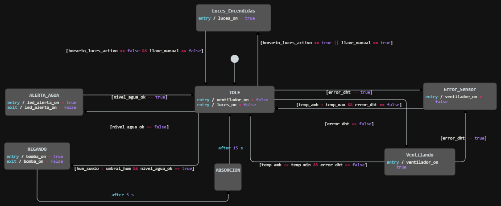

# **SmartGrow (Cuidador de Planta Automático)**

**Autores: [Lucas Santiago Pozo, Nicolás Uriel Koo, Andrés Maturano]**

**Padrón: [113786, 113609, 113884]**

**Fecha: 2do cuatrimestre 2026**

---

### **1. Selección del proyecto a implementar**

#### **1.1 Objetivo del proyecto y resultados esperados**
El objetivo de este proyecto es diseñar e implementar un sistema de cuidado de plantas automático para monitorear, controlar y registrar las condiciones ambientales y del suelo de cultivos en interiores (hogares o pequeñas oficinas). Se tiene como objetivo adicional asegurar que el mantenimiento de la planta sea lo más autónomo posible, promoviendo un crecimiento saludable mediante el control preciso del riego, la ventilación y la iluminación (luces rojas para estimulación fotosintética). Por último, se busca en este proyecto poder visualizar el estado de la planta en tiempo real y modificar los parámetros de cuidado (umbrales de temperatura y humedad) a través de una aplicación o interfaz web.

#### **1.2 Proyectos similares**
Se consideran tres tipos de proyectos posibles que cumplen con los objetivos generales de cuidado de cultivos, todos basados en sistemas de cultivo en interiores:

1. Cuidador automático integral con sensores (suelo y ambiente), ventilación, luz roja y registro en la nube.
2. Sistema hidropónico avanzado con control de nutrientes, PH, luces de espectro completo y conectividad.
3. Maceta de autorriego temporizado básico (sin sensores ambientales ni luz, accionado solo por tiempo).

Para comparar estas alternativas, se tienen en cuenta seis aspectos característicos:

1. **Disponibilidad del hardware:** Se evalúa si el proyecto es fácilmente implementable con componentes electrónicos y bombas de agua disponibles en mercados regionales.
2. **Nivel de autonomía:** Se comprende por autonomía a la capacidad del sistema de mantener la planta viva y en condiciones óptimas sin intervención humana directa.
3. **Confiabilidad/Estabilidad:** Se comprende por confiabilidad a la robustez del sistema frente a fallos (por ejemplo, regar de más y ahogar la planta, o falsas lecturas).
4. **Tiempo de implementación:** Tiempo total que llevará diseñar, programar e implementar el hardware y software del proyecto seleccionado.
5. **Costo:** El costo total del proyecto.
6. **Interés personal.**

Se decide ponderar los aspectos de la siguiente manera del 1 al 10: Disponibilidad del hardware: 10, Nivel de autonomía: 8, Confiabilidad/Estabilidad: 6, Tiempo de implementación: 8, Costo: 5, Interés personal: 8.

La disponibilidad del hardware es fundamental ya que para este proyecto no se busca salir del mercado regional para importar sensores industriales o bombas costosas. La autonomía es primordial también porque es el principal valor agregado del proyecto; se busca solucionar la falta de tiempo de los usuarios para cuidar sus plantas. La confiabilidad se elige con ponderación 6 porque, si bien es importante no dañar la planta, el entorno de interiores es controlado y menos propenso a factores extremos que desestabilicen los sensores. El tiempo de implementación se elige con un valor de 8 dado que se requiere implementar el proyecto en un periodo de tiempo acotado (un cuatrimestre). El costo se pondera en 5 dado que se busca una buena solución tecnológica y se está dispuesto a invertir en ella, siempre que no escale a los precios de sistemas hidropónicos de nivel comercial. Finalmente, el interés personal toma particular relevancia dado que se busca realizar un proyecto motivador que integre hardware, software y biología, valuando ese aspecto con un puntaje de 8.

La siguiente tabla (Tabla 1.2.1) muestra los valores ponderados asignados a cada proyecto considerado:

<table>
    <thead>
        <tr>
            <th rowspan="2">Proyecto</th>
            <th colspan="2">Cuidador integral (Sensores + Nube)</th>
            <th colspan="2">Hidropónico avanzado (PH + Nutrientes)</th>
            <th colspan="2">Maceta temporizada (Solo riego)</th>
        </tr>
        <tr>
            <th>Puntaje</th>
            <th>Puntaje Ponderado</th>
            <th>Puntaje</th>
            <th>Puntaje Ponderado</th>
            <th>Puntaje</th>
            <th>Puntaje Ponderado</th>
        </tr>
    </thead>
    <tbody>
        <tr>
            <td align="center"><strong>Disponibilidad de Hardware</strong> (peso : 10)</td>
            <td align="center">9</td>
            <td align="center">90</td>
            <td align="center">4</td>
            <td align="center">40</td>
            <td align="center">10</td>
            <td align="center">100</td>
        </tr>
        <tr>
            <td align="center"><strong>Nivel de Autonomía</strong> (peso : 8)</td>
            <td align="center">9</td>
            <td align="center">72</td>
            <td align="center">10</td>
            <td align="center">80</td>
            <td align="center">3</td>
            <td align="center">24</td>
        </tr>
        <tr>
            <td align="center"><strong>Confiabilidad / Estabilidad</strong> (peso : 6)</td>
            <td align="center">8</td>
            <td align="center">48</td>
            <td align="center">7</td>
            <td align="center">42</td>
            <td align="center">5</td>
            <td align="center">30</td>
        </tr>
        <tr>
            <td align="center"><strong>Tiempo de Implementación</strong> (peso : 8)</td>
            <td align="center">7</td>
            <td align="center">56</td>
            <td align="center">3</td>
            <td align="center">24</td>
            <td align="center">10</td>
            <td align="center">80</td>
        </tr>
        <tr>
            <td align="center"><strong>Costo</strong> (peso : 5)</td>
            <td align="center">7</td>
            <td align="center">35</td>
            <td align="center">3</td>
            <td align="center">15</td>
            <td align="center">9</td>
            <td align="center">45</td>
        </tr>
        <tr>
            <td align="center"><strong>Interés personal</strong> (peso : 8)</td>
            <td align="center">10</td>
            <td align="center">80</td>
            <td align="center">8</td>
            <td align="center">64</td>
            <td align="center">4</td>
            <td align="center">32</td>
        </tr>
        <tr>
            <td><strong>Puntaje Total</strong></td>
            <td align="center">-</td>
            <td align="center"><strong>381</strong></td>
            <td align="center">-</td>
            <td align="center">265</td>
            <td align="center">-</td>
            <td align="center">311</td>
        </tr>
    </tbody>
</table>

<em>Tabla 1.2.1: Comparación de proyectos</em>

#### **1.3 Selección de proyecto**
Considerando la Tabla 1.2.1, se elige implementar el **Cuidador automático integral con sensores, luces y ventilación**. El sistema hidropónico avanzado requiere mucho tiempo de implementación, calibración constante de electrodos de PH y bombas dosificadoras de nutrientes, lo cual excedería el tiempo y presupuesto propuesto. Por otro lado, la maceta de autorriego temporizado, si bien es muy barata y rápida de armar, carece de feedback (lazo cerrado); al no medir la humedad real del suelo, puede ahogar la planta o secarla si cambian las condiciones climáticas, y tiene un interés personal bajo por su simpleza.

Debido a estas razones, el proyecto a implementar utilizará sensores de humedad de suelo, sensores de temperatura/humedad ambiente (ej. DHT11/DHT22), un sistema de luces rojas para floración/fotosíntesis, ventilación forzada para control de temperatura ambiente y una bomba de agua. La combinación de estos actuadores y sensores forma un ecosistema de lazo cerrado ideal.

En Argentina, cada vez más personas viven en departamentos sin balcones o con poca exposición solar y carecen de tiempo para mantener plantas (ya sean ornamentales o huertas aromáticas). Este proyecto busca una solución tecnológica para que cualquier persona pueda cultivar en interiores sin conocimientos previos de botánica. El proyecto se destaca por incorporar un módulo Wi-Fi que permite registrar los datos en la nube y visualizarlos en una app, permitiendo además forzar riegos o modificar los umbrales operativos de forma remota. 

Los desafíos principales de este proyecto son la convivencia segura entre electrónica y agua (aislamiento), la calibración correcta del sensor de humedad de suelo para evitar corrosión prematura (usando sensores capacitivos en lugar de resistivos) y la lógica de control para evitar rebotes (ej. que la bomba no encienda y apague constantemente por variaciones mínimas de lectura).

###### **1.3.1 Diagrama en bloques**
En la Figura 1.3.1 se muestra el diagrama en bloques del sistema con los principales módulos del proyecto, incluyendo los actuadores (luces, bomba, ventilador) y los sensores integrados al microcontrolador principal.

  

<em>Figura x.x: Diagrama de estados unificado</em>

---

### **2. Elicitación de requisitos y casos de uso**

En el mercado global existen productos de características similares a las del proyecto, conocidos como "Smart Gardens" (jardines inteligentes). Sin embargo, en Argentina la oferta de estos productos es limitada, muy costosa y a menudo basada en ecosistemas cerrados (cápsulas de semillas propietarias).

Como primer competidor se puede mencionar a **Click & Grow**, que ofrece jardines de interior con luces LED y riego pasivo (capilaridad). Sus productos son muy estéticos pero cerrados, el usuario debe comprar sus "pods" de tierra y semillas específicos, y los modelos base no cuentan con sensores ambientales ni ventilación activa, limitando el control real.

Un segundo competidor es **AeroGarden**, cuyos sistemas sí poseen bombas de agua temporizadas y notificaciones. Los precios son elevados y requieren importación. Además, la mayoría de estos sistemas carece de ventilación forzada, la cual es crítica en interiores para evitar la proliferación de hongos en las hojas y fortalecer el tallo de la planta, característica que nuestro proyecto sí incluye, sumado a la iluminación LED roja específica.

En resumen, el mercado local carece de una solución abierta, adaptable a macetas tradicionales y que ofrezca un monitoreo ambiental completo a un costo accesible.

| Grupo | ID | Descripción |
| :--- | :--- | :--- |
| **Actuadores de Riego** | 1.1 | El sistema contará con una micro-bomba de agua para regar la planta. |
| | 1.2 | El sistema accionará la bomba únicamente cuando la lectura de humedad del suelo caiga por debajo del umbral configurado. |
| **Climatización** | 2.1 | El sistema contará con un ventilador para renovar el aire y reducir la temperatura/humedad superficial. |
| | 2.2 | El ventilador se activará automáticamente si la temperatura o humedad ambiente supera el umbral máximo. |
| **Iluminación** | 3.1 | El sistema contará con paneles o tiras de luz LED roja orientadas a la planta. |
| | 3.2 | El encendido de las luces rojas seguirá un ciclo diario programable (fotoperíodo). |
| **Sensores** | 4.1 | El sistema contará con un sensor de humedad de suelo (preferentemente capacitivo). |
| | 4.2 | El sistema contará con un sensor de temperatura y humedad ambiente. |
| **Indicadores** | 5.1 | El sistema contará con un indicador visual (LED) para alertar cuando el depósito de agua general esté vacío o bajo. |
| | 5.2 | El sistema contará con indicadores de estado de conexión Wi-Fi (conectando, conectado, error). |
| **Comunicación Wi-Fi** | 6.1 | El sistema se conectará a una red Wi-Fi local para interactuar con la nube/aplicación. |
| | 6.2 | El sistema enviará periódicamente los datos de temperatura, humedad ambiente y humedad del suelo a la base de datos. |
| | 6.3 | El sistema deberá recibir comandos manuales (forzar riego, encender luces, modificar umbrales) desde la aplicación. |
| **Aplicación** | 7.1 | La aplicación mostrará un panel de control con los valores actuales de los sensores. |
| | 7.2 | La aplicación deberá permitirle al usuario ajustar los umbrales de humedad de suelo que disparan el riego. |
| | 7.3 | La aplicación mostrará un historial o gráfico de las variables medidas en los últimos días. |

<em>Tabla 2.1: Requisitos del proyecto</em>

En las tablas 2.2 a 2.4 se presentan 3 casos de uso principales para el sistema.

| Elemento | Definición |
| :--- | :--- |
| **Disparador** | La humedad del suelo desciende por debajo del umbral mínimo configurado. |
| **Precondiciones** | El sistema está encendido. El depósito de agua tiene suficiente nivel. La conexión Wi-Fi está activa. |
| **Flujo principal** | El sensor de suelo detecta que la humedad ha bajado del 30% (umbral configurado). El microcontrolador procesa la lectura y enciende la micro-bomba de agua durante un tiempo preestablecido (ej. 5 segundos). Luego de accionar la bomba, el sistema espera un "tiempo de absorción" para volver a medir la humedad y evitar regar de más. Se envía una notificación y un registro a la aplicación indicando que se ha realizado un riego automático. |
| **Flujos alternativos** | **a.** El sistema intenta regar pero detecta (mediante un sensor de nivel o por falta de cambio en la humedad del suelo tras varios intentos) que el depósito de agua está vacío. El sistema detiene la bomba para no quemarla, enciende el LED indicador de falta de agua y envía una alerta a la aplicación. **b.** El usuario cambia el umbral desde la aplicación justo antes del riego, retrasando la acción si el nuevo umbral es más bajo. |

<em>Tabla 2.2: Caso de uso 1: Riego automático por baja humedad</em>

| Elemento | Definición |
| :--- | :--- |
| **Disparador** | La temperatura ambiente supera el umbral máximo de confort de la planta. |
| **Precondiciones** | El sistema está encendido y el sensor DHT/ambiental funcionando correctamente. |
| **Flujo principal** | El sensor ambiental detecta una temperatura de 32°C, superando el umbral de 28°C fijado por el usuario. El sistema acciona el relé o transistor que enciende el ventilador. El ventilador funciona continuamente renovando el aire del entorno. Una vez que la temperatura ambiente vuelve a descender a 27°C (umbral con histéresis), el ventilador se apaga. Se registra el evento en la plataforma en la nube. |
| **Flujos alternativos** | **a.** El sensor ambiental se desconecta o falla; el sistema arroja una lectura de error y envía una notificación a la aplicación, apagando actuadores por seguridad para no dejarlos encendidos infinitamente. |

<em>Tabla 2.3: Caso de uso 2: Activación de ventilación por alta temperatura</em>

| Elemento | Definición |
| :--- | :--- |
| **Disparador** | El usuario desea encender las luces rojas manualmente fuera del horario programado. |
| **Precondiciones** | El sistema está encendido y conectado a la red Wi-Fi. La aplicación está abierta en el dispositivo del usuario. |
| **Flujo principal** | El usuario ingresa a la aplicación y presiona el botón "Encender luces". La orden viaja por la nube hasta el microcontrolador del proyecto. El microcontrolador recibe el mensaje (MQTT/HTTP), acciona el circuito de iluminación LED roja y devuelve un mensaje de confirmación de estado. La interfaz de la aplicación actualiza el icono de la luz a "encendido". |
| **Flujos alternativos** | **a.** Hay pérdida de conexión Wi-Fi en el dispositivo. La orden nunca llega y la aplicación muestra un "Error de conexión", las luces permanecen apagadas. **b.** Las luces ya se encontraban encendidas por el temporizador automático; la aplicación informa que el estado actual ya es "Encendido". |

<em>Tabla 2.4: Caso de uso 3: Control remoto de iluminación desde la Aplicación</em>

